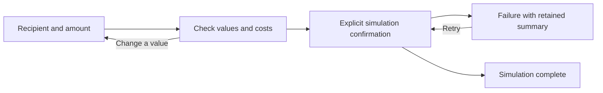

# Worked UX plan: a simulated transfer

This is a hand-authored planning example for the reference-led skill workflow. It is not a generated UI, a new benchmark run, or evidence that the revised skill improves outcomes. It uses the same fictional transfer task as the exploratory pilot to make structural choices concrete.

## Task and constraints

- Occasional customer: enter a recipient and amount, understand the full consequence, review, then confirm a simulation.
- Required relationships: recipient + destination; sent amount + flat fee + debited total; exchange rate + amount received; delivery + confirmation.
- Example only: USD 250 sent, USD 2.50 fee, USD 252.50 total, VND 6,250,000 received at 25,000 VND/USD. Long Vietnamese recipient names must remain intact.
- First simulated confirmation fails recoverably, retry succeeds, and input/context remain available. No real payment or account connection.
- No existing design system. Narrow-screen reading, focus, font coverage, and visible consequences remain constraints regardless of styling.

## Reference observations

- [GOV.UK check answers](https://design-system.service.gov.uk/patterns/check-answers/), documentation inspected 1 November 2026: review values before submission, provide meaningful changes, and retain previously entered answers. Adapt the review/edit relationship, not government branding. Target UI not rendered; no code copied.
- [VoltAgent Wise analysis](https://github.com/VoltAgent/awesome-design-md/blob/fcc70284932276d085f01ef9f83edde90b1258cb/design-md/wise/DESIGN.md), source Markdown inspected: a community visual-language interpretation, including marketing display treatment. It may inform a separately chosen visual tone, but does not establish the best structure for this transfer. Its large display treatment is not the starting point for the working screen. No tokens/fonts/assets imported.

## Candidate A — focused task and check-answers

```text
ENTRY                              REVIEW
Recipient                         Back to details
Amount + currency                 Check your transfer
Fee / rate / received preview     Recipient                 Change
[Review transfer]                 You send                  Change
                                  Fee
                                  TOTAL DEBITED
                                  Recipient receives
                                  Delivery estimate
                                  [Confirm simulated transfer]
```

The initial page starts with useful input, not a promise panel. Review groups comparable money values into one ledger. The review action and commitment have different labels. On narrow screens the same logical sequence remains; long names wrap beside their label, not into a detached floating card.

Tradeoff: an extra review step, justified here by recipient/cost confirmation and the explicit task request. Re-entering an edit returns to review without replaying irrelevant steps.

## Candidate B — continuous calculation workbench

```text
Recipient + amount       LIVE CONSEQUENCE LEDGER
Editable details         Amount / fee / total / received / arrival
                         [Review these details]

REVIEW MODE: values and change actions remain near the ledger;
commit is explicit and is not triggered while adjusting an amount.
```

This keeps the calculation consequences visible during adjustment. On narrow screens the ledger follows the amount and precedes the action. Tradeoff: users must understand when they are editing versus committing; duplicated confirmation buttons or a persistent action covering values would weaken it.

## Selection

Choose A for this occasional, short transfer flow: explicit review and correction are easier to explain, and a single working column is sufficient. B is viable when repeated adjustment is central. A branching wizard was considered but is not a useful third candidate for only two independent inputs; it adds navigation without resolving a dependency. No structure is chosen at random.

In either choice, a large left headline plus isolated form panel contributes little unless it answers a real trust or eligibility question. Trust information belongs near the relevant consequence, using concrete copy rather than occupying half the screen by default.

## State and acceptance plan



- Before commitment, the recipient, debited total, received amount, and delivery are explicit; the user need not perform arithmetic.
- Invalid amount preserves recipient. Review changes preserve values and return to review.
- Error explains the failed action and recovery; success has distinct semantics and presentation rather than inheriting error styling.
- Test 390px and wide layouts, long names, keyboard focus after state changes, zoom, and real font glyph coverage. A zero-overflow check alone is insufficient.
- Only after the structure is selected, choose or generate tokens. Contrast, typography, and motion must support the working ledger and labels. This example has not implemented or rendered that visual treatment.
